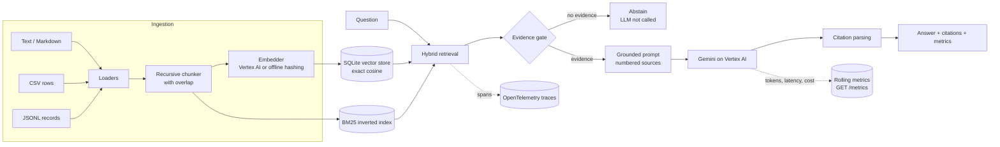

# rag-service-gcp

A production-style Retrieval-Augmented Generation (RAG) service in Python. It ingests unstructured documents and structured records, builds a hybrid (vector + BM25) index, and answers questions with numbered citations, or abstains when the corpus has no evidence. Every request is traced with OpenTelemetry and measured for tokens/sec, cost per request and latency percentiles.

The production backend is **Gemini on Vertex AI** (embeddings and generation), deployable to **Cloud Run**. An offline backend keeps the whole system testable without cloud credentials, which is how CI runs.



## What it demonstrates

| Area | Implementation |
|---|---|
| Structured and unstructured data | Markdown/text documents, CSV rows and JSONL records (each row keeps its column names as text and metadata) |
| Chunking | Recursive splitter preferring paragraph, then sentence, then word boundaries, with word-aligned overlap |
| Vector database | SQLite-backed store behind a `VectorStore` protocol; pgvector or Vertex AI Vector Search can replace it without touching the pipeline |
| Hybrid retrieval | Dense cosine search and a from-scratch Okapi BM25 index, merged with Reciprocal Rank Fusion |
| Grounding | Numbered sources, mandatory inline citations, an explicit "I don't know" path, and a prompt-injection guard |
| Cost control | The evidence gate abstains without calling the model when nothing in the corpus matches |
| Tracing | Nested spans `rag.query` → `rag.retrieve` / `rag.generate` with model, token, tokens/sec and cost attributes |
| LLM-native metrics | Tokens/sec, cost per request, p50/p95 latency, abstain rate, token totals (`GET /metrics`) |
| Evaluation | Golden-set harness reporting recall@k, MRR, abstention accuracy and citation rate; enforced as a test gate |
| Serving | FastAPI with input validation, Dockerfile, Cloud Run deploy script, GitHub Actions CI |

## Quickstart (offline, no credentials)

```bash
python -m venv .venv && source .venv/bin/activate
pip install -e ".[dev]"

pytest -q                       # 44 tests, including the golden-set quality gate
ruff check .

ragservice --store demo.sqlite ingest data/docs/*.md data/tickets.csv data/products.jsonl
ragservice --store demo.sqlite ask "How long are audit logs retained?"
ragservice --store demo.sqlite ask "What is the capital of France?"   # abstains
ragservice --store demo.sqlite eval --golden eval/golden.jsonl
```

Run the API:

```bash
uvicorn ragservice.api:app --reload
curl -s localhost:8000/documents -H 'content-type: application/json' \
  -d '{"source": "data/tickets.csv", "content": "id,issue\n1,SAML login loop", "format": "csv"}'
curl -s localhost:8000/query -H 'content-type: application/json' \
  -d '{"question": "Why does SAML login loop?"}'
curl -s localhost:8000/metrics
```

## Using Gemini on Vertex AI

```bash
pip install -e ".[gcp]"
gcloud auth application-default login
export LLM_BACKEND=gemini EMBEDDER=vertex GCP_PROJECT=your-project GCP_LOCATION=us-central1
export STORE_PATH=vertex.sqlite   # use a fresh store: embedding dimensions differ by backend
ragservice ingest data/docs/*.md data/tickets.csv data/products.jsonl
ragservice ask "How long is the refund window for annual subscriptions?"
```

Cloud Run deployment is in `deploy/cloudrun.sh`. The service account needs `roles/aiplatform.user`. The script deploys with `--no-allow-unauthenticated`, so callers must present an identity token.

## Metrics

Every answered request yields a `RequestMetrics` record, returned in the response and aggregated at `GET /metrics`.

- **Tokens per second** = completion tokens ÷ generation time.
- **Cost per request** = prompt tokens × input rate + completion tokens × output rate. Rates come from `PRICE_INPUT_PER_MTOK` and `PRICE_OUTPUT_PER_MTOK`. The defaults are placeholders, so set them to your model's current list price.
- **Latency** is end to end, with p50 and p95 over a rolling window. Retrieval time is recorded separately.
- **Abstain rate** is the share of requests that never reached the model.

## Evaluation results

Run on the bundled corpus (3 documents, 1 CSV, 1 JSONL file) with the offline backend, using `eval/golden.jsonl` (14 questions: 11 answerable, 3 off-topic):

| Metric | Result |
|---|---|
| Recall@4 | 1.00 |
| MRR | 0.95 |
| Correct abstention on off-topic questions | 3 / 3 |
| False abstention on answerable questions | 0 / 11 |
| Citation rate on answered questions | 1.00 |

These numbers come from a small, hand-written golden set over a synthetic corpus. They are a regression gate, not a benchmark, and they say nothing about how a Gemini model would score. Throughput is not reported for the offline backend. Its "generation" is a sentence selector, so tokens/sec numbers from it mean nothing.

## Design decisions

- **Hybrid retrieval.** Dense vectors capture paraphrase and BM25 captures exact identifiers such as SKUs, ticket IDs and product names. RRF merges the two rankings without needing their scores to be comparable.
- **Evidence gate.** A question is answered only if a content term appears in the corpus or the best cosine clears `MIN_SIMILARITY`. Off-topic questions never reach the model, which saves cost and blocks many hallucinations. The threshold is calibrated per embedder, because cosine scales differ between models.
- **Grounding contract.** Sources are numbered and must be cited. Citations are parsed and validated against the number of sources. An answer with no valid citation is marked `grounded: false` so callers can handle it.
- **Protocols at the seams.** `Embedder`, `VectorStore` and `LLM` are small protocols. Tests use fakes, and the Vertex adapters are constructor-injectable.
- **Telemetry is injected.** The pipeline takes a tracer, so the console exporter can be used in development and OTLP in production without code changes.

## Configuration

| Variable | Default | Purpose |
|---|---|---|
| `LLM_BACKEND` | `extractive` | `gemini` or `extractive` (offline) |
| `EMBEDDER` | `hashing` | `vertex` or `hashing` (offline) |
| `GEMINI_MODEL` | `gemini-2.5-flash` | Vertex generation model |
| `EMBEDDING_MODEL` | `text-embedding-005` | Vertex embedding model |
| `GCP_PROJECT`, `GCP_LOCATION` | unset, `us-central1` | Vertex AI location |
| `STORE_PATH` | `ragservice.sqlite` | SQLite index file |
| `TOP_K` | `4` | Sources passed to the model |
| `MIN_SIMILARITY` | `0.2` | Embedding gate threshold (calibrate per embedder) |
| `PRICE_INPUT_PER_MTOK`, `PRICE_OUTPUT_PER_MTOK` | `0.30`, `2.50` | Placeholder USD rates for cost metrics |
| `TRACE_EXPORTER` | unset | `console` prints spans to stdout |

## Verification status

- **Verified here:** lint, all 44 unit and integration tests, the offline evaluation, and the FastAPI routes through `TestClient`.
- **Covered by tests with fake clients only:** the Gemini generation and Vertex embedding adapters, including how usage metadata maps to token counts and how embedding requests are batched. These have not been run against live Vertex AI in this repository.
- **Not verified here:** the Docker image build and the Cloud Run deployment.

## Limitations and next steps

- Vector search is exact brute force over a SQLite store. That is fine up to a few hundred thousand chunks. Beyond that, move to pgvector with an HNSW index or Vertex AI Vector Search.
- Cloud Run's filesystem is ephemeral, so a SQLite index does not survive restarts or scale-out. Production needs a managed vector store.
- Ingestion is synchronous and serialised by one lock. Large corpora should go through a job queue.
- The plural folding is deliberately crude, not a full stemmer.
- The API has no application-level auth. It relies on Cloud Run IAM, and an API gateway in front of it would be the next step.
- Live Gemini evaluation (groundedness and answer quality judged by a rubric or an LLM judge) is the obvious next addition to the golden-set harness.
